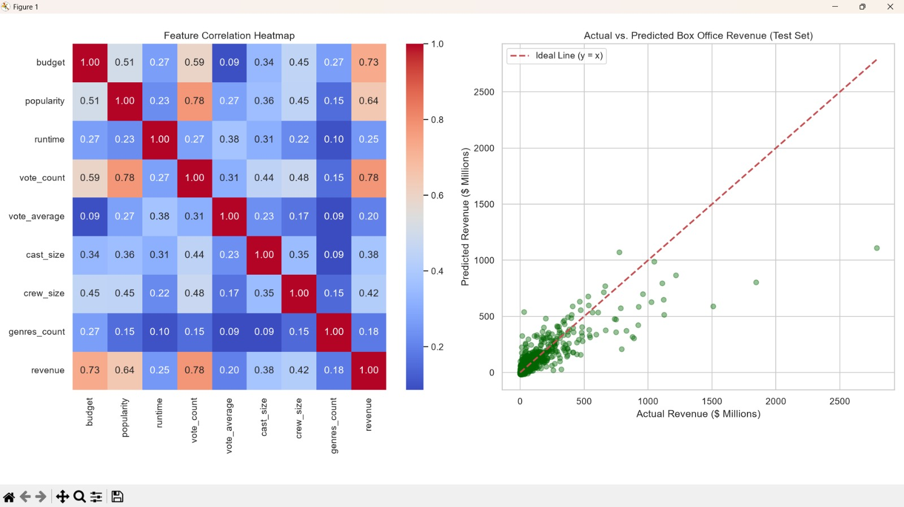

# Movie Box Office Collection Predictor

A Machine Learning Mini-Project that uses movie metadata and Linear Regression to predict movie box-office revenue.

**Course:** AI101 Mini-Project  
**Institution:** School of AI and Data Engineering, IIT Ropar

---

## 1. Project Overview

The Movie Box Office Collection Predictor is a machine learning project that aims to estimate a movie's box-office revenue using information such as its budget, popularity, runtime, vote count and other movie-related features.

The project uses the TMDB 5000 Movie Metadata dataset and applies data preprocessing, exploratory data analysis and Linear Regression to develop a predictive model.

### Problem Statement

Predict movie box-office revenue using available movie metadata and understand how different movie characteristics relate to revenue.

### Objectives

- Explore and understand movie metadata.
- Clean and preprocess the dataset.
- Identify relevant features for revenue prediction.
- Train a Linear Regression model.
- Evaluate model performance using standard regression metrics.
- Visualise actual and predicted revenue.

## 2. Team Members and Roles
- Manan Khurana   : 2026EEB1375 : Executive lead
- Venktesh Sharma : 2026AIB1094 : Documentation lead 
- Harshit Jethani : 2026DAB1294 : Ppt lead
- Arunima         : 2026MCB1514 : Video lead 

All team members contributed to the project through their assigned responsibilities. Individual contributions can also be viewed through the GitHub commit history.

## 3. Dataset Description

**Dataset:** TMDB 5000 Movie Metadata

**Source:** Kaggle

**Dataset Link:** https://www.kaggle.com/datasets/tmdb/tmdb-movie-metadata

The dataset contains information about approximately 5,000 movies, including:

- Movie budget
- Movie revenue
- Popularity
- Runtime
- Vote count
- Vote average
- Genres
- Cast
- Crew
- Other movie metadata

The dataset consists of two main CSV files:

1. `tmdb_5000_movies.csv`
2. `tmdb_5000_credits.csv`

These datasets are merged using the movie identifier to create a combined dataset for analysis.

**Prediction Target:** `revenue`

The objective is to predict movie box-office revenue, not movie ratings.

## 4. Technologies and Libraries Used

| Technology | Purpose |
|---|---|
| Python | Programming language |
| Pandas | Data manipulation |
| NumPy | Numerical calculations |
| Matplotlib | Data visualisation |
| Seaborn | Statistical visualisation |
| Scikit-learn | Machine learning |
| KaggleHub | Dataset downloading |
| Jupyter Notebook | Interactive coding and results |

## 5. Project Structure

```text
ai101-team-40-movie-boxoffice-collection-predictor/
│
├── dataset/
│   ├── tmdb_5000_movies.csv
│   └── tmdb_5000_credits.csv
│
├── src/
│   ├── __init__.py
│   ├── data_preprocessing.py
│   ├── model.py
│   └── evaluation.py
│
├── main.py
├── main.ipynb
├── requirements.txt
├── README.md
└── .gitignore
```

### File Descriptions

- `main.ipynb` – Complete project notebook containing the combined code, section-wise explanations, execution results, evaluation metrics and visualisations. This is the main interactive project demonstration.
- `main.py` – Main Python program that connects the different project modules and executes the workflow.
- `data_preprocessing.py` – Handles dataset loading, merging, cleaning and feature preparation.
- `model.py` – Contains the Linear Regression model training and prediction functionality.
- `evaluation.py` – Calculates model performance metrics and generates result visualisations.
- `__init__.py` – Identifies the `src` directory as a Python package.
- `dataset/` – Stores the two TMDB CSV dataset files.
- `requirements.txt` – Lists the Python libraries required to run the project.
- `.gitignore` – Excludes unnecessary generated files and folders.

## 6. Setup and Installation

### Requirements

- Python 3.10 or later
- pip package manager
- Git
- VS Code or Jupyter Notebook

### Step 1: Clone the Repository

```bash
git clone https://github.com/venky-mew/ai101-team-40-movie-boxoffice-collection-predictor.git
```

### Step 2: Open the Project Folder

```bash
cd ai101-team-40-movie-boxoffice-collection-predictor
```

### Step 3: Create a Virtual Environment

For Windows:

```bash
python -m venv venv
```

Activate it:

```bash
venv\Scripts\activate
```

For macOS/Linux:

```bash
python3 -m venv venv
```

```bash
source venv/bin/activate
```

### Step 4: Install Dependencies

```bash
pip install -r requirements.txt
```

### Step 5: Run the Project

**Option A: Using Jupyter Notebook**

Start Jupyter Notebook:

```bash
jupyter notebook
```

Open `main.ipynb` and execute the cells in order using Run All.

**Option B: Using Python Files**

```bash
python main.py
```

## 7. Dataset Setup

The project uses the TMDB 5000 Movie Metadata dataset from Kaggle.

The dataset contains two CSV files:

- `tmdb_5000_movies.csv`
- `tmdb_5000_credits.csv`

Both files should be placed inside the `dataset` folder in the main project directory.

Dataset download link:

https://www.kaggle.com/datasets/tmdb/tmdb-movie-metadata

The project may also use KaggleHub to download the dataset automatically, depending on the dataset-loading method used in the code.

If Kaggle authentication is required, configure Kaggle access before running the project.

## 8. Methodology

The project follows these major steps:

### 1. Data Loading

Load the TMDB movie metadata and credits datasets.

### 2. Data Merging

Combine both datasets using their common movie identifier.

### 3. Exploratory Data Analysis

Examine the dataset structure, descriptive statistics, missing values and relationships between numerical features.

### 4. Data Preprocessing

- Handle missing values.
- Extract useful information from movie metadata.
- Prepare numerical input features.
- Select the revenue prediction target.

### 5. Feature Selection

Select relevant movie features for the prediction model.

### 6. Train-Test Split

Divide the prepared data into training and testing sets.

### 7. Feature Scaling

Apply feature scaling where required by the model pipeline.

### 8. Model Training

Train a Linear Regression model using the training dataset.

### 9. Prediction

Use the trained model to estimate movie box-office revenue.

### 10. Model Evaluation

Evaluate the predictions using standard regression performance metrics.

## 9. Model Evaluation

The project uses the following evaluation metrics:

| Metric | Purpose |
|---|---|
| MAE | Measures average absolute prediction error |
| MSE | Measures average squared prediction error |
| RMSE | Measures prediction error in the original target units |
| R² Score | Measures how much variation in the target is explained by the model |

The project also includes visualisations such as:

- Correlation heatmap.
- Actual vs Predicted Revenue graph.

## 10. Results and Output

The complete execution results are available in `main.ipynb`.

The notebook contains:

1. Dataset information and descriptive statistics.
2. Data preprocessing results.
3. Exploratory data analysis.
4. Model training.
5. Predicted movie revenue values.
6. MAE, MSE, RMSE and R² evaluation scores.
7. Actual vs Predicted Revenue visualisation.

**Output Screenshot:**



The notebook includes the code and saved execution outputs so that the project workflow and results can be reviewed.

## 11. Project Presentation

**Presentation Slides (PDF):**

https://drive.google.com/file/d/1zar3MSWJBscqDwZlgJGGYZz0EdCjK3ZE/view?usp=drivesdk

**Project Demonstration Video:**

https://drive.google.com/file/d/1LgKNGtB1vr96Enxt01c5_8jCQDQGqGvI/view?usp=drivesdk

The demonstration video covers:

- Introduction of team members and their contributions.
- Problem statement and project objectives.
- Dataset description.
- Code demonstration.
- Model results and discussion.

Every team member participates in the project presentation.

## 12. AI-Use Disclosure

AI tools, including ChatGPT, were used as supporting tools during different stages of this mini-project.

AI assistance was used for:

- Understanding machine learning concepts and Python programming.
- Assisting with code development, organisation and debugging.
- Improving the structure and organisation of the project.
- Preparing and refining project documentation.
- Assisting with the preparation and organisation of the PDF presentation.

AI tools served as supporting resources throughout the project development process.

## 13. Limitations

- Movie revenue depends on many factors that may not be available in the dataset.
- The dataset may contain missing or inaccurate values.
- Linear Regression may not capture complex relationships between movie features and revenue.
- Predictions are estimates and are not guaranteed actual box-office collections.
- Model performance depends on data quality and feature selection.

## 14. Future Improvements

- Experiment with more advanced regression algorithms.
- Include additional movie-related features.
- Improve data cleaning and feature engineering.
- Compare different machine learning models.
- Improve prediction accuracy through model optimisation.

## 15. Conclusion

This project demonstrates how machine learning can be applied to movie metadata to estimate box-office revenue.

By combining data preprocessing, exploratory data analysis, Linear Regression and model evaluation, the project provides an introductory approach to revenue prediction using Python.

---

**GitHub Repository:**"https://github.com/venky-mew/ai101-team-40-movie-boxoffice-collection-predictor"

**Institution:** IIT Ropar – School of AI and Data Engineering

**Course:** AI101 Mini-Project